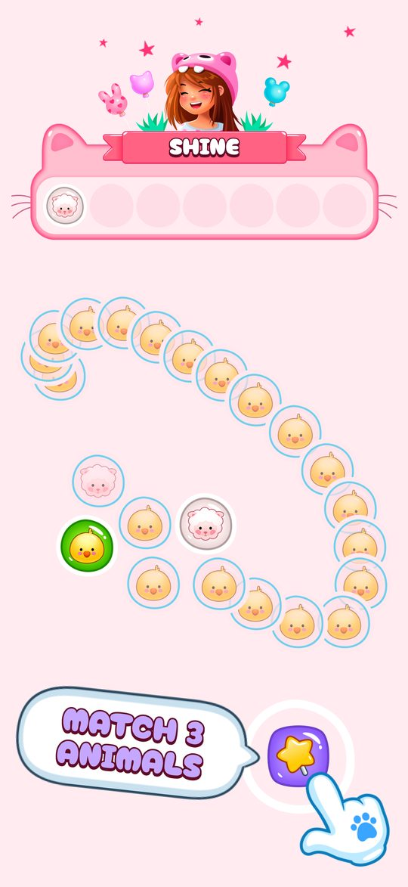

# Pet Match: Zoo Animal Puzzle

**Pet Match: Zoo Animal Puzzle لعبة مطابقة بلاطات ثلاثية مجانية وهادئة مع حيوانات لطيفة، لأجهزة iPhone وiPhone Duo وiPad. اضغط على حيوان لإرساله إلى صينية من 7 خانات، وتختفي ثلاثة حيوانات متشابهة. أفرغ اللوحة لتفوز بالمستوى. تعمل اللعبة دون اتصال، بلا Wi-Fi وبلا حساب، وليس فيها مؤقت ولا أرواح.**

[نزّل Pet Match من App Store](https://apps.apple.com/app/id6738354347)

## طريقة اللعب

1. اضغط على فقاعة حيوان لا يغطيها شيء لترسلها إلى الصينية.
2. تختفي ثلاثة حيوانات متشابهة في الصينية.
3. أفرغ اللوحة لتفوز. في الصينية 7 خانات فقط، فخطّط مسبقًا.

علقت؟ أربعة معززات تساعدك: تراجع، خلط، مغناطيس وسحر. كل القواعد والنصائح: [طريقة اللعب](how-to-play).

## ما الذي يميزها

- **كل مستوى صورة.** تشكّل الفقاعات 142 شكلًا: وجه قطة، سمكة، بومة، كب كيك، صاروخ، دب محشو والمزيد. [كل المستويات](levels).
- **كل مستوى قابل للفوز.** فُحصت المستويات الـ200 كلها ببرنامج حلّ، ويمكن إنهاؤها دون معززات.
- **بلا مؤقت، بلا أرواح، بلا انتظار.** خسرت مستوى؟ حاول من جديد فورًا، كم مرة تشاء.
- **13 حيوانًا:** كتاكيت، أرانب، دببة، ثعالب، بطاريق، باندا، بوم، فيلة، زرافات، جراء، خنازير صغيرة، وحيدات القرن وخراف.
- **بداية هادئة.** أول 19 مستوى بلا إعلانات، ولا يجتمع فيها حيوانان متقاربان في اللون في المستوى نفسه.

## لمن هذه اللعبة

لكل من يريد لغزًا هادئًا لاستراحة قصيرة أو في الطريق أو على متن الطائرة، ولمحبي ألعاب مطابقة البلاطات والمطابقة الثلاثية وألعاب الماهجونغ مع حيوانات لطيفة. يلعبها الكبار للاسترخاء، وهي سهلة بما يكفي للأطفال والأجداد أيضًا.

## أسئلة وأجوبة

**هل تعمل Pet Match دون إنترنت؟** نعم. كل المستويات تُلعب دون اتصال بالإنترنت.

**هل هي مجانية؟** نعم. التنزيل واللعب مجانيان. المشتريات الاختيارية داخل التطبيق تضيف معززات وتزيل الإعلانات.

**هل فيها إعلانات؟** أول 19 مستوى بلا إعلانات. تبدأ الإعلانات من المستوى 20، وشراء "بلا إعلانات" يزيل اللافتات والإعلانات بملء الشاشة.

**هل فيها مؤقت أو أرواح؟** لا. لا مؤقت ولا أرواح، فلا تنتظر أبدًا لتلعب من جديد.

**هل يمكن الفوز بكل مستوى؟** نعم. فُحص كل مستوى ببرنامج حلّ، ويمكن الفوز به دون معززات.

**كم عدد المستويات؟** 200 مستوى، من الهادئ إلى المحيّر. بعد المستوى 200 تعود المستويات من 101 إلى 200 مع خلط جديد للحيوانات.

**ما الحيوانات الموجودة في اللعبة؟** كتاكيت، أرانب، دببة، ثعالب، بطاريق، باندا، بوم، فيلة، زرافات، جراء، خنازير صغيرة، وحيدات القرن وخراف.

**هل أحتاج إلى حساب؟** لا. لا يوجد تسجيل. يُحفظ تقدّمك على جهازك وفي حساب iCloud الخاص بك.

**هل تعمل على iPhone Duo؟** نعم. تتكيّف اللوحة مع الشاشة مطويّة أو مفتوحة.

**ما اللغات المتاحة؟** 37 لغة. تتبع اللعبة لغة جهاز iPhone لديك.

**هل هي لعبة مطابقة ثلاثية من نوع match-3؟** ليست من النوع الذي تُبدّل فيه القطع. تختار الحيوانات إلى صينية وتزيلها ثلاثًا ثلاثًا، ويُسمّى هذا مطابقة البلاطات الثلاثية (triple tile match).

## الدعم

لديك سؤال أو مشكلة أو فكرة؟ اكتب إلى **7tam.official@gmail.com**. نردّ على كل رسالة، عادةً خلال يومين.

- **استعادة المشتريات** على هاتف جديد أو بعد إعادة التثبيت: اضغط زر الترس أعلى شاشة اللعبة، ثم "استعادة المشتريات".
- **الاشتراكات:** تمكن إدارتها أو إلغاؤها من إعدادات iOS > [اسمك] > الاشتراكات.
- **تقدّمك** محفوظ على جهازك، وإذا كنت قد سجّلت الدخول إلى iCloud ففي حساب iCloud الخاص بك أيضًا، ليعود إليك على جهاز iPhone أو iPad جديد.
- **الإعلانات** تبدأ من المستوى 20. ويزيل "بدون إعلانات" اللافتات والإعلانات بملء الشاشة.

[طريقة اللعب](how-to-play) · [المستويات](levels) · [سياسة الخصوصية](privacy) · [شروط الاستخدام](terms) · [English](../)

