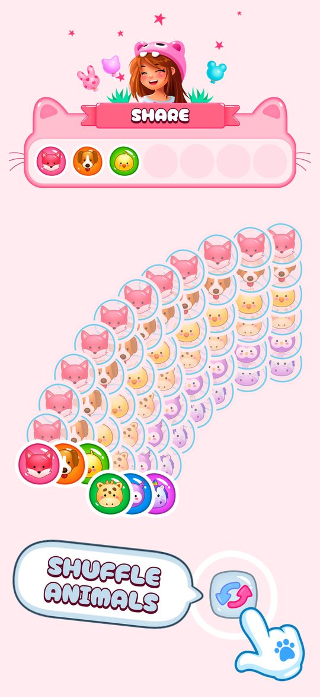

# How to play Pet Match

**Pet Match: Zoo Animal Puzzle is a triple tile match game. You tap animal bubbles to move them into a
tray of 7 slots, three of the same animal clear, and you win when the board is empty. There is no timer
and no lives: if the tray fills up, you simply try the level again.**

[Download Pet Match on the App Store](https://apps.apple.com/app/id6738354347)

## The rules

1. Each level is a picture made of animal bubbles: a cat face, a fish, a cupcake, a rocket and 138 more shapes.
2. Only bubbles that nothing covers can be tapped. Tapping one sends that animal to the tray at the top of the screen.
3. Three of the same animal in the tray disappear.
4. The tray holds 7 animals. If it fills up with no three of a kind, the level is lost and you start it again.
5. Clear every bubble to win.

## Boosters

- **Undo** puts the last animal from the tray back on the board.
- **Shuffle** mixes the animals that are still on the board.
- **Magnet** lifts the last animals out of the tray into a side bar, so the tray has room again.
- **Magic Wand** clears three of the same animal straight from the board.

In the first levels the boosters are free and only need a few seconds to recharge. Later each booster
has a counter; you refill it by watching a short video or with an in-app purchase.

## Tips

- Look before you tap: count how many of each animal you can reach.
- Keep two free slots in the tray when you can. A full tray ends the level.
- Open the bubbles that cover many others first.
- Every level has been checked by a solver and can be won without boosters.

## Ads

The first 19 levels have no ads. From level 20 the game shows a banner and a short ad between levels;
No Ads removes both.

[Back to the game page](./) · [Levels](levels) · [Privacy Policy](privacy) · [Terms of Use](terms)

