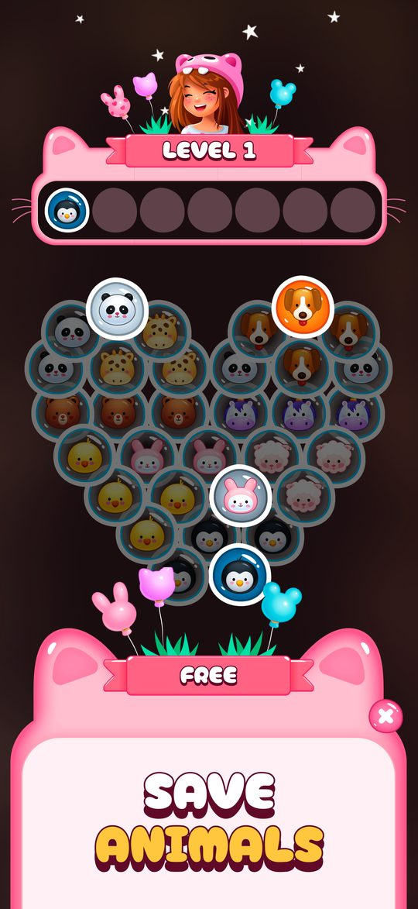

# Pet Match: Zoo Animal Puzzle

**Pet Match: Zoo Animal Puzzle 是一款免费、轻松的三消方块配对游戏，主角是可爱的动物，适用于 iPhone、iPhone Duo 和 iPad。点击动物把它送进 7 格托盘，三个相同的动物就会消除。清空棋盘即可过关。可离线游玩，无需 Wi-Fi，也无需注册账号；不限时，也没有体力。**

[在 App Store 下载 Pet Match](https://apps.apple.com/app/id6738354347)

## 玩法

1. 点击没有被遮挡的动物泡泡，它会飞进托盘。
2. 托盘里三个相同的动物会消除。
3. 清空棋盘就能过关。托盘只有 7 格，要提前规划。

卡关了？四个道具来帮忙：撤销、打乱、磁铁和魔法。完整规则和技巧：[玩法](how-to-play)。

## 与众不同之处

- **每一关都是一幅图。** 泡泡拼成 142 种图案：猫脸、小鱼、猫头鹰、纸杯蛋糕、火箭、泰迪熊等等。[全部关卡](levels)。
- **每一关都能通过。** 全部 200 关都经过求解程序验证，不用道具也能通关。
- **不限时、没有体力、无需等待。** 失败了马上再来，想玩多少次都行。
- **13 种动物：** 小鸡、小兔、小熊、小狐狸、企鹅、熊猫、猫头鹰、大象、长颈鹿、小狗、小猪、独角兽和小羊。
- **轻松开局。** 前 19 关没有广告，而且颜色相近的动物不会出现在同一关。

## 适合谁

适合想在短暂休息、通勤或乘飞机时玩一会儿安静益智游戏的人，也适合喜欢可爱动物方块配对、三消和麻将连连看类游戏的玩家。大人用它放松解压；规则简单，小朋友和爷爷奶奶也能轻松上手。

## 常见问题

**Pet Match 可以离线玩吗？** 可以。所有关卡都无需联网。

**免费吗？** 免费。下载和游玩都免费。可选的 App 内购买提供道具并移除广告。

**有广告吗？** 前 19 关没有广告。从第 20 关开始有广告，购买“去广告”可移除横幅和全屏广告。

**有时间限制或体力吗？** 没有。不限时，也没有体力，随时都能再玩。

**每一关都能通过吗？** 能。每一关都经过求解程序验证，不用道具也能通关。

**有多少关？** 200 关，从轻松到烧脑。第 200 关之后，第 101 至 200 关会换一种动物组合再次出现。

**游戏里有哪些动物？** 小鸡、小兔、小熊、小狐狸、企鹅、熊猫、猫头鹰、大象、长颈鹿、小狗、小猪、独角兽和小羊。

**需要账号吗？** 不需要，无需注册。进度保存在你的设备和你自己的 iCloud 中。

**支持 iPhone Duo 吗？** 支持。无论折叠还是展开，棋盘都会适配屏幕。

**支持哪些语言？** 37 种语言，游戏会跟随 iPhone 的语言。

**这是消消乐那种三消吗？** 不是交换位置的那种。你把动物放进托盘，三个一组消除，这类玩法叫做三消方块配对（triple tile match）。

## 支持

有问题、遇到故障或有好点子？请发送邮件至 **7tam.official@gmail.com**。我们会回复每一封邮件，通常在两天内。

- **恢复购买**（新手机或重新安装后）：轻点游戏画面顶部的齿轮按钮，然后轻点“恢复购买”。
- **订阅：**可在 iOS 的“设置”>［您的姓名］>“订阅”中管理或取消。
- **您的进度**保存在您的设备上；如果您已登录 iCloud，也会保存在您自己的 iCloud 账户中，因此可以在新的 iPhone 或 iPad 上继续。
- **广告**从第 20 关开始出现。购买“去广告”可去除横幅广告和全屏广告。

[玩法](how-to-play) · [关卡](levels) · [隐私政策](privacy) · [使用条款](terms) · [English](../)

