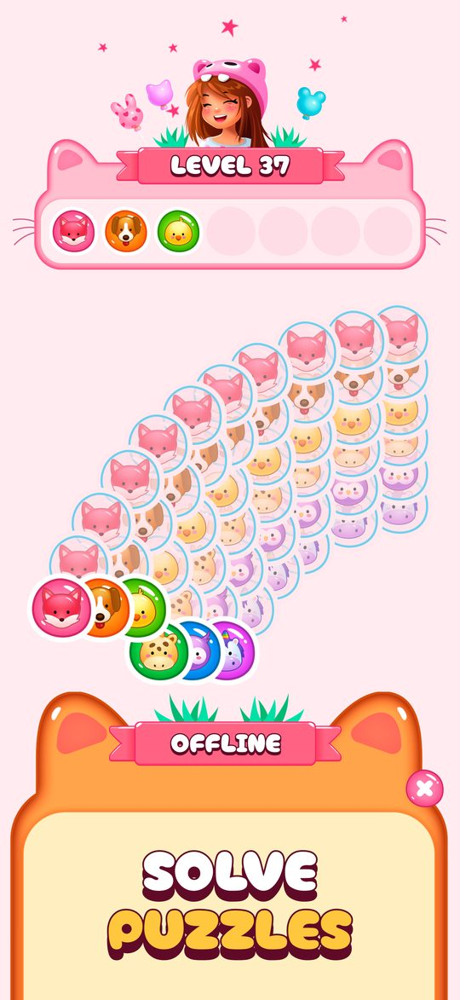

# Pet Match 的關卡

**Pet Match: 動物消除益智遊戲 共有 200 關，每一關都是由動物泡泡組成的一幅圖：貓臉、小魚、貓頭鷹、紙杯蛋糕、火箭、泰迪熊等，共 142 種圖案。每一關都經過求解程式驗證，不用道具也能通關。第 200 關之後，第 101 至 200 關會換一種動物組合再次出現。**

[在 App Store 下載 Pet Match](https://apps.apple.com/app/id6738354347)

## 關卡長什麼樣

- **動物：** 貓、貓臉、狗、小雞、兔子、熊、狐狸、豬、熊貓、企鵝、貓頭鷹、長頸鹿、大象、獅子、老虎、考拉、浣熊、猴子、倉鼠、老鼠、綿羊、奶牛、青蛙、鴨子、烏龜、鯨魚、魚、螃蟹、章魚、水母、海星、蛇、獨角獸、蝴蝶、瓢蟲。
- **美食和甜點：** 蘋果、梨、檸檬、櫻桃、草莓、葡萄、胡蘿蔔、蘑菇、南瓜、乳酪、披薩、餅乾、甜甜圈、紙杯蛋糕、蛋糕、冰淇淋、冰棒、棒棒糖、糖果、煎蛋。
- **玩具和物品：** 泰迪熊、氣球、球、毛線團、禮物、火箭、城堡、房子、狗屋、鳥屋、帳篷、雨傘、茶杯、禮帽、耳機、皇冠、獎牌、鑰匙、磁鐵、魔法棒。
- **自然和圖形：** 花、鬱金香、四葉草、樹葉、樹、松樹、仙人掌、太陽、月亮、星星、雲、雨滴、山、海浪、雪人、幽靈、愛心、菱形、螺旋等。

## 難不難？

前幾關很輕鬆，用來熟悉規則。第 20 關難度會明顯提升，之後慢慢增加。前 19 關裡，顏色相近的兩種動物不會出現在同一關，很容易分辨。

## 你要配對的動物

小雞、小兔、小熊、小狐狸、企鵝、熊貓、貓頭鷹、大象、長頸鹿、小狗、小豬、獨角獸和小羊：共 13 種動物。

[遊戲主頁](./) · [玩法](how-to-play) · [隱私政策](privacy) · [使用條款](terms) · [English](../levels)
